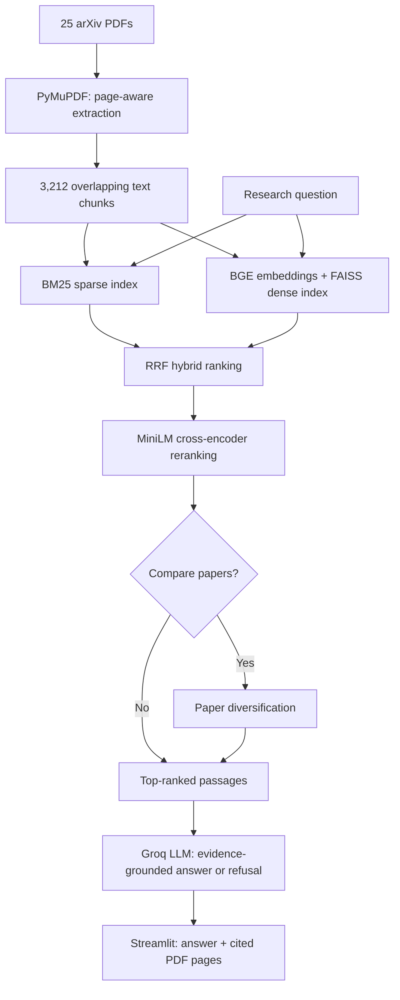

# ResearchLens

**A citation-aware research assistant for influential AI/ML papers, built with hybrid retrieval, cross-encoder reranking, and grounded LLM generation.**

ResearchLens lets you ask questions across a curated collection of **25 research papers (679 PDF pages)**. It retrieves relevant passages, generates an answer using the retrieved evidence, and links citations to the original papers and PDF pages. It can also decline questions when the available evidence is insufficient.

> **Status:** Working local Streamlit application. The GitHub repository contains the source code and evaluation artifacts; there is no hosted demo yet.

## Features

- **Hybrid search:** BM25 lexical retrieval + BGE dense embeddings in FAISS, merged with reciprocal rank fusion (RRF).
- **Cross-encoder reranking:** Reranks the top 30 hybrid candidates before answer generation.
- **Evidence-linked answers:** Groq-hosted `openai/gpt-oss-120b` generates answers with validated passage identifiers and paper/page links.
- **Opt-in cross-paper comparison:** A two-passages-per-paper cap improves representation of distinct papers, with documented retrieval trade-offs.
- **Evidence-aware refusal:** The assistant can decline when retrieved passages do not establish an answer.
- **Streamlit interface:** Light/dark modes, paper library, and local SQLite conversation history.

## Architecture



**Core settings:** ~900-character chunks with 150-character overlap; `BAAI/bge-small-en-v1.5` (384-dimensional embeddings); FAISS inner-product search over normalized vectors; RRF with `k=60`; `cross-encoder/ms-marco-MiniLM-L-6-v2`; optional diversification capped at two chunks per paper.

## Evaluation

A manually prepared **50-question gold set** comprises 20 single-paper questions, 10 definition/method questions, 15 cross-paper comparisons, and 5 deliberately unanswerable questions. The 45 answerable questions have **61 paper/page evidence assignments**. Retrieval systems were evaluated against these labels, separately from answer generation.

| Retrieval system | Single/definition Recall@5 | Comparison paper coverage@5 | Full paper coverage@5 |
|:--|--:|--:|--:|
| BM25 | 0.667 | 0.744 | 0.467 |
| Dense (BGE + FAISS) | 0.700 | 0.844 | 0.667 |
| Hybrid (RRF) | 0.667 | 0.811 | 0.600 |
| **Hybrid + rerank** | **0.733** | 0.811 | 0.600 |
| Hybrid + diversify | 0.367 | **1.000** | **1.000** |
| Hybrid + rerank + diversify | 0.433 | 0.944 | 0.867 |

**How to read this:** Single/definition `Recall@5` is the fraction of questions with at least one passage from the required paper **and a labeled gold PDF page** in the first five results. Comparison coverage is the average fraction of required papers retrieved; *full coverage* requires all specified papers to appear. Paper coverage does **not** imply that the correct evidence pages were retrieved.

**Finding:** Unconditional diversification improves cross-paper representation but can substantially reduce precise page retrieval for single-paper questions. Consequently, the application uses the reranked baseline for standard questions and makes diversification an explicit comparison-mode option. The combined interactive strategy has not been evaluated as a separate end-to-end system.

A generation smoke test declined all **5/5** unanswerable gold questions. This is a small sample, **not** a general reliability, factual-faithfulness, or false-abstention guarantee.

See [`eval/results/ablation.md`](eval/results/ablation.md), [`eval/results/ablation.csv`](eval/results/ablation.csv), and [`eval/gold.jsonl`](eval/gold.jsonl) for detailed results and benchmark labels. The recorded benchmark was run on a CPU-based WSL environment; latency depends on hardware.

## Run locally

**Tested environment:** Python 3.12 on WSL Ubuntu (CPU). Initial setup downloads model weights and approximately 74 MB of research PDFs, so allow time and disk space.

```bash
git clone https://github.com/yasharth-stack17/ResearchLens.git
cd ResearchLens
python3 -m venv .venv
source .venv/bin/activate
python -m pip install --upgrade pip
pip install -r requirements.txt
```

The PDFs and generated FAISS/BM25 indexes are intentionally **not** stored in Git. Build them locally, in order:

```bash
python src/download.py     # fetch and verify 25 paper PDFs; writes data/meta.json
python src/ingest.py       # extract and chunk the papers; writes data/chunks.jsonl
python src/index.py        # build FAISS and BM25 indexes in data/index/
```

Create a local Groq API configuration:

```bash
cp .env.example .env
```

Edit `.env` and set `GROQ_API_KEY` to your own key. Do not commit or share it. Then launch:

```bash
streamlit run app.py
```

Open the local URL Streamlit prints (typically `http://localhost:8501`). Choose **Compare papers** for cross-paper questions; otherwise use standard retrieval. Questions are answered independently, even when they appear in the same saved chat.

### CLI and evaluation

```bash
python src/generate.py "What is NF4 and why does QLoRA use it?"
python src/generate.py "How do LoRA and QLoRA differ?" --compare
python src/evaluate.py
```

**Note:** Running `src/evaluate.py` regenerates files under `eval/results/`; use Git to inspect any differences from the committed benchmark.

## Repository structure

```text
app.py                   Streamlit interface
.streamlit/              App theme and configuration
src/
  download.py            arXiv collection + metadata
  ingest.py              PDF extraction and chunking
  index.py               FAISS/BM25 index construction
  retrieve.py            Sparse, dense, and hybrid retrieval
  rerank.py              Cross-encoder reranking
  diversify.py           Paper-level diversification
  evaluate.py            Retrieval ablations and metrics
  llm.py                 Groq provider, retries, response cache
  generate.py            RAG orchestration and citation mapping
  history.py             Local SQLite conversation storage
eval/
  gold.jsonl             50-question benchmark
  results/               Per-query outputs and ablation tables
data/
  meta.json              Paper metadata
  raw/                   Downloaded PDFs (not tracked)
  index/                 Generated search indexes (not tracked)
```

## Limitations and privacy

- **Fixed corpus:** Only the 25 selected papers are indexed; arbitrary PDF upload is not supported.
- **Grounding is imperfect:** The system validates citation identifiers against retrieved passages but does not independently verify that every generated claim is entailed by its cited text. Incorrect or incomplete answers remain possible.
- **Retrieval trade-offs:** Comparison-mode diversification can miss the precise source pages even when it covers both papers.
- **No conversational reasoning across turns:** Saved conversations preserve messages and citations; follow-up questions are still processed independently.
- **PDF page links:** Links target arXiv PDFs and may point to a different page if the online paper has been revised since indexing.
- **Local history:** SQLite persistence is intended for a single-user environment. For an unauthenticated public deployment, launch with `RESEARCHLENS_PUBLIC=1` to use session-only history rather than a shared persistent chat database. A secure multi-user deployment would need authentication and user-isolated storage.
- **External service:** Answer generation sends questions and retrieved passages to Groq; an internet connection and API credentials are required.

Built as an experimental research-engineering project. Evaluation artifacts and measured results are available in the repository for inspection.
